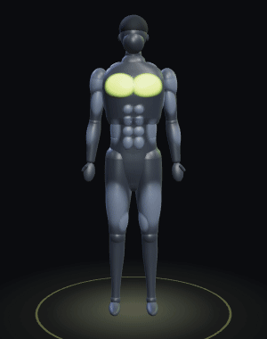

# FIT / AI — мобильное фитнес-приложение



React Native + Expo SDK 57 + TypeScript + Expo Router. Тёмная тема с лаймовым акцентом.

## Что уже работает (MVP)

| Раздел | Что внутри |
|---|---|
| Онбординг | Модель (муж/жен), уровень (новичок/средний/профи), цель (6 вариантов), дом/зал/смешанно + инвентарь, 2–6 тренировок в неделю, длительность, срок 4/8/12 недель, рост/вес/возраст, особая ситуация, тип питания, аллергии, число приёмов пищи |
| План | Генератор программы: фулбоди / верх-низ / жим-тяга-ноги в зависимости от уровня и дней; подходы, повторы, отдых и RPE под цель; блоки по 4 недели с разгрузочной неделей; перенос тренировки на свободный день; замена упражнения, если тренажёр занят |
| Тренировка | Разминка, упражнения, кнопка «Показать технику» (3D и видео), подсказки, логирование веса и повторов по подходам, таймер отдыха с вибрацией, прошлые веса, оценка самочувствия |
| Мышцы | Вращаемая 3D-модель мужчины и женщины с рельефом мышц (плюс 2D-схема как запасной вариант); нажатие на мышцу подсвечивает её и показывает функцию и упражнения по эффективности с фильтрами (дом/зал, уровень, инвентарь) и раскрытыми критериями оценки |
| Упражнения | 89 упражнений: 3D-анимация техники на модели (со штангой, гантелями, гирей, скамьёй, турником), видео техники с YouTube для каждого упражнения, пошаговая техника, дыхание, частые ошибки, подсказки, проще/сложнее, замены; поиск и фильтры |
| Питание | Калории по формуле Миффлина — Сан Жеора с показом допущений, БЖУ, план на 7 дней с учётом диеты и аллергий, редактирование граммов, замена продукта на похожий по ценности, добавление продуктов, список покупок; безопасный минимум калорий |
| ИИ-тренер | Чат на Claude через серверный адаптер: знает профиль, план недели и последние тренировки; ограничения безопасности; быстрые вопросы; кнопка «Спросить ИИ» из карточки упражнения |
| Прогресс | Регулярность за 8 недель, тоннаж, подходы, личные рекорды, история |
| Профиль | Редактирование всех ответов с пересозданием плана, удаление истории чата и всех данных |

Данные хранятся на устройстве (AsyncStorage).

## Запуск приложения

```bash
npm install
npx expo start
```

Отсканируйте QR-код приложением **Expo Go** (Android) или камерой (iOS). Для веб-версии нажмите `w`.

## Телефон без компьютера (24/7)

Всё, кроме ИИ-тренера, работает прямо на телефоне: данные хранятся на устройстве, сервер не нужен.

1. **Android-приложение (APK).** При каждом push в `main` GitHub Actions собирает APK (`.github/workflows/android.yml`). Скачайте `fit-ai.apk` на телефоне со страницы **Releases → latest-android** и установите (разрешите установку из браузера).
2. **Веб-версия.** Тот же push публикует сайт на GitHub Pages (`.github/workflows/web.yml`): `https://<логин>.github.io/<репозиторий>/`. Подходит и для iPhone: «Поделиться → На экран „Домой“». Один раз включите Pages: Settings → Pages → Source: **GitHub Actions**.
3. **ИИ-тренер 24/7.** Серверу нужен хостинг: на Render.com выберите New → Blueprint → этот репозиторий (`render.yaml`), задайте `ANTHROPIC_API_KEY`. Полученный адрес (`https://fit-ai-coach.onrender.com`) запишите в Settings → Secrets and variables → Actions → **Variables** → `EXPO_PUBLIC_API_URL` и перезапустите сборки. Бесплатный тариф Render засыпает без запросов, первый ответ после паузы может идти до минуты.
4. **iPhone как приложение из App Store** требует аккаунт Apple Developer ($99 в год) и сборку через EAS (`npx eas build -p ios`).

## Запуск ИИ-тренера

Ключ Claude хранится только на сервере, в приложение он не попадает.

```bash
cd server
npm install
ANTHROPIC_API_KEY=sk-ant-... npm start      # http://localhost:8787
```

Затем в корне приложения создайте `.env` (см. `.env.example`):

```
EXPO_PUBLIC_API_URL=http://<IP вашего компьютера>:8787
```

и перезапустите `npx expo start`. Без сервера чат честно показывает, что ИИ не подключён.

Модель по умолчанию `claude-opus-5-5` (можно сменить переменной `CLAUDE_MODEL`). Для продакшена сервер нужно развернуть на хостинге (Render, Railway, VPS) и добавить авторизацию пользователей.

## 3D-модель и видео

- `scene3d/scene.ts` — сцена three.js: модель тела (мужская и женская) с рельефом мышц, выбор мышцы касанием, вращение, анимация техники и снаряды.
- `scene3d/patterns.ts` — ключевые позы движений (~50 шаблонов: присед, жим, тяга, планка, мост и т. д.).
- `src/data/animations.ts` — какой шаблон и снаряд показывать для каждого упражнения.
- `src/data/videos.ts` — видео YouTube для каждого упражнения с автором; все ролики проверены через YouTube oEmbed (доступны для встраивания).
- Сцена собирается в одну HTML-строку и работает в WebView на телефоне и в iframe в вебе. После правок в `scene3d/` выполните:

```bash
npm run build:3d   # пересобирает src/components/body3d/sceneHtml.ts
```

Если на устройстве нет WebGL, приложение автоматически показывает 2D-схему.

## Структура

```
src/
  app/            экраны (Expo Router): (tabs)/ главная, план, мышцы, питание, ИИ-тренер;
                  onboarding, exercise/[id], workout/[id], session/[id], library, progress, profile, shopping
  components/     UI-кит, 3D-модель Body3D, 2D-карта BodyMap, блок техники (3D + YouTube), форма профиля
  data/           упражнения, мышечные группы, 3D-анимации, видео, продукты и шаблоны блюд
  lib/            генератор программы (plan.ts), питание (nutrition.ts), клиент ИИ (ai.ts)
  store/          состояние (zustand + AsyncStorage)
server/           ИИ-адаптер на Node.js + Anthropic SDK
scene3d/          исходники 3D-сцены (three.js), сборка: npm run build:3d
```

## Что дальше

- **Свои видео.** Сейчас видео техники встроены с YouTube (официальный плеер, автор указан). Когда появятся собственные ролики, укажите их в поле `video` упражнения (`src/data/exercises.ts`): они автоматически заменят YouTube, плеер `expo-video` уже подключён.
- **Анатомическая модель.** 3D-модель собственная (процедурная, без лицензионных ограничений). Если позже купить детальную анатомическую GLB-модель, её можно загрузить в ту же сцену: id мышц и протокол сообщений не меняются.
- **Бэкенд.** Аккаунты, синхронизация между устройствами, PostgreSQL (по ТЗ Laravel или другой стек).
- Казахский и английский языки, уведомления, графики рабочих весов по упражнениям.

## Проверки

```bash
npx tsc --noEmit
npx expo export --platform web   # проверка сборки
```
